<div align="center">


# Bloxi

**Un mundo 3D de bloques para niños: arma tu monito, vístelo con disfraces chistosos y juega minijuegos.**
Sin cuentas · Sin chat · Sin anuncios · Funciona sin internet · Salas privadas con amigos

[](https://github.com/EdgarLeonArchuleta19/bloxi/actions/workflows/deploy.yml)

### 👉 [Jugar ahora](https://edgarleonarchuleta19.github.io/bloxi/) 👈

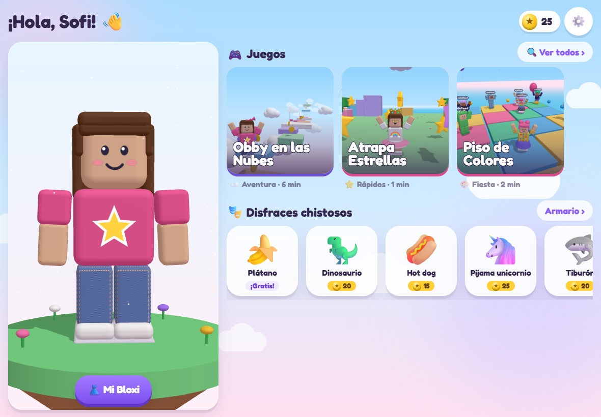

</div>

---

## ✨ ¿Qué es Bloxi?

Bloxi es una app web (PWA) pensada para **tablets como el iPad**. Los niños crean su personaje de bloques, ganan monedas jugando
y las cambian por ropa, disfraces y accesorios. Todo pasa **dentro del dispositivo**: no hay otros jugadores, no se habla con
nadie y no se envía ningún dato a internet.

## 🛡️ Hecho para que sea seguro

| | |
|---|---|
| 🚫 **Sin cuentas** | Solo pide un nombre para saludar, y se queda en el dispositivo |
| 💬 **Sin chat** | Nadie puede escribirle. Para jugar con otros solo existen **salas privadas con código** (y los papás las pueden apagar) |
| 💸 **Sin compras reales ni anuncios** | Las monedas solo se ganan jugando |
| 📡 **Sin internet** | Después de abrirlo una vez funciona en modo avión (solo las salas con amigos usan internet) |
| 🔐 **Control para papás** | Borrar el progreso pide resolver una multiplicación |

## 👗 El armario

Más de **100 cosas** para vestir a tu Bloxi. Cada prenda tiene su propio color y diseño, hay **una gratis de cada tipo** y los
precios son bajitos.

<div align="center">

</div>

**🎭 12 disfraces chistosos:** plátano, hot dog, pizza, robot de caja, dinosaurio, tiburón, pingüino, payasito, pijama de unicornio,
princesa, superhéroe y astronauta.


**👕 Ropa:** 17 playeras, 6 pantalones, 6 shorts, 6 faldas y tutús, y 7 tipos de tenis (¡incluye pantuflas de conejo y tenis con luces!).

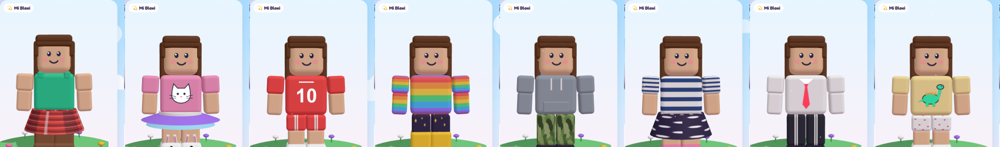

**💇‍♀️ 20 peinados** (cola de caballo, trenzas, chonguitos, melenita, ondulado, corona trenzada, sirena súper largo…) con 16 colores de pelo.

**👑 Y más:** 9 caras, 11 gorros, 5 lentes y 7 cosas para la espalda (alas que aletean, capa, jetpack).
También tiene un botón **🎲 ¡Sorpréndeme!** que arma un outfit al azar.

## 🏙️ Mi Ciudad (modo principal)

Un mundo semi-abierto para pasear libremente:

- 🏠 **Tu casita** con jardín y letrero con tu nombre (y una siesta 😴)
- 🍦 **Heladería**, 🍕 **Pizzería** y 🎈 **globos**: se compran con monedas y los cargas en la mano (¡y tus amigos también reciben!)
- 👗 **Tienda de ropa**: abre el armario sin salir de la ciudad
- ⛲ **Fuente de los deseos**
- 🚗 **Carritos y motos** para manejar por las calles (¡con claxon!)
- 🧒 **Bots** que pasean, platican y se pueden volver **tus amigos 💖**: te siguen por toda la ciudad y se quedan guardados (y si quieres, dejan de seguirte con 👋 *Ya no ser amigos*)
- 🐶 **Tienda de mascotas**: adopta un perrito, gatito o conejito que te sigue
- 🎡 **Feria** con rueda de la fortuna y carrusel (¡te puedes subir!), 🏖️ **lago** con patitos, 🏫 **escuela** con datos curiosos y 🚒 **bomberos** con camión para manejar
- 🚕 **Tráfico**: carros que circulan solos y se paran si estás enfrente
- 🌙 **Día y noche**: atardece, salen la luna y las estrellas, y se prenden las ventanas y los faroles (dormir en tu casita te lleva a la mañana)
- 🪙 Monedas regadas por toda la ciudad

<div align="center">
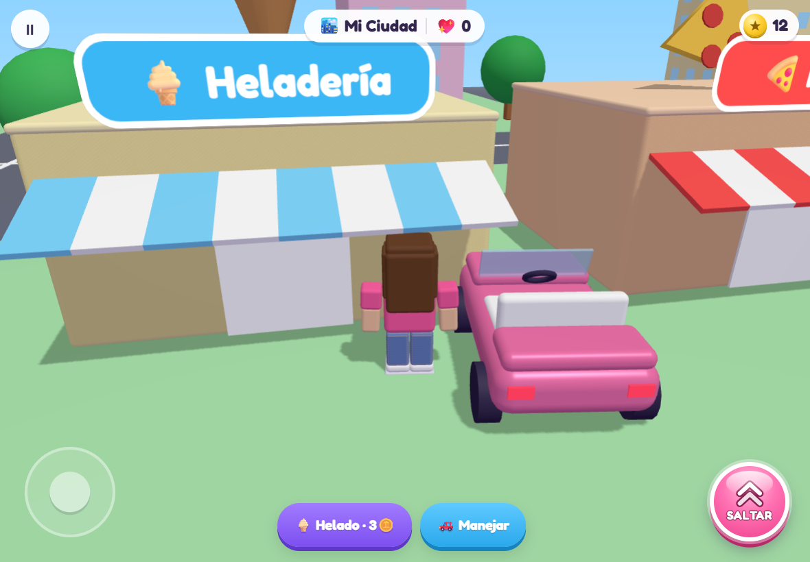
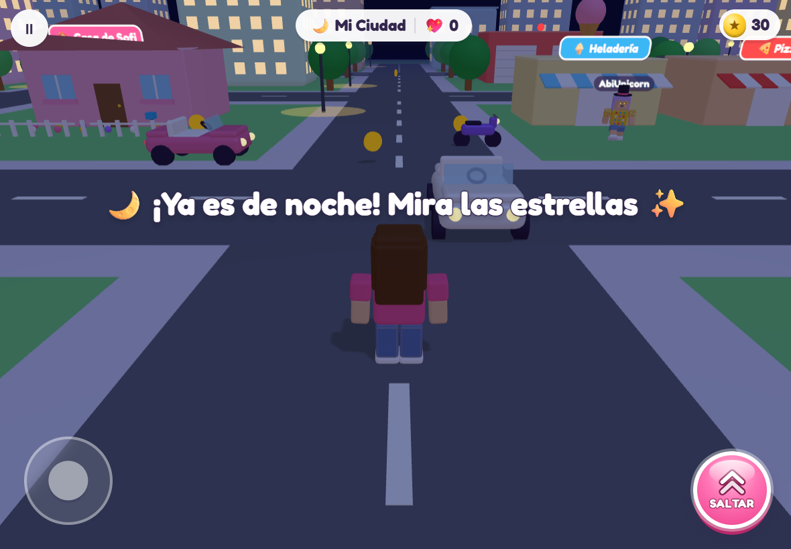
</div>

## 🎮 Minijuegos

<div align="center">
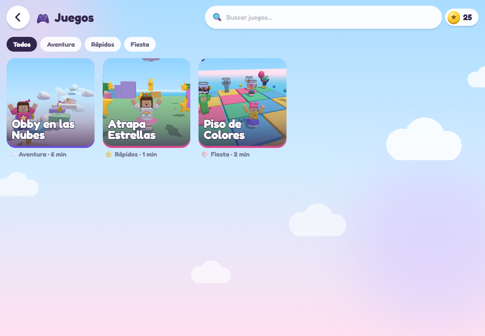
</div>

| Juego | De qué se trata |
|---|---|
| ☁️ **Obby en las Nubes** | Parkour de **8 etapas** en el cielo: escalones, plataformas que se mueven, trampolines, puente angosto, plataformas que desaparecen 👻, piedritas sobre lava 🔥, escalera al cielo con elevador y final arcoíris 🌈. Si te caes regresas al checkpoint, y **se guarda tu avance** para seguir otro día. |
| ⭐ **Atrapa Estrellas** | 60 segundos para juntar estrellas en una isla con árboles, torres y trampolines. ¡Las estrellas arcoíris valen triple! |
| 🏎️ **Carreritas** | Carreras de karts contra 5 bots: pedal verde para acelerar y joystick suave para girar (con ayudita para no salirse). Turbos ⚡ en la pista y 3 vueltas. |
| 🚔 **Escapa de la Cárcel** | ¡Te encerraron por error! Busca la llave 🔑, toma la tarjeta 💳 escondiéndote de los guardias 👮 detrás de las cajas, cruza el patio sin que te alumbren los reflectores 🔦, trepa el muro y escápate en globo 🎈. |
| 🌋 **El Piso es Lava** | Cuando suena la alarma, ¡súbete a un mueble antes de que el piso se vuelva lava! 10 rondas contra 7 bots y cada ronda se hunde un mueble. |
| 🎨 **Piso de Colores** | ¡Contra 7 jugadores bot 🤖 con nombres y outfits al azar! Sale un color y hay que pararse en él antes de que los demás cuadros se caigan al agua. Gana quien quede al final (🥇🥈🥉). Tú tienes 3 vidas ❤️❤️❤️. Los bots son de mentiritas: todo pasa en el dispositivo. |

<div align="center">
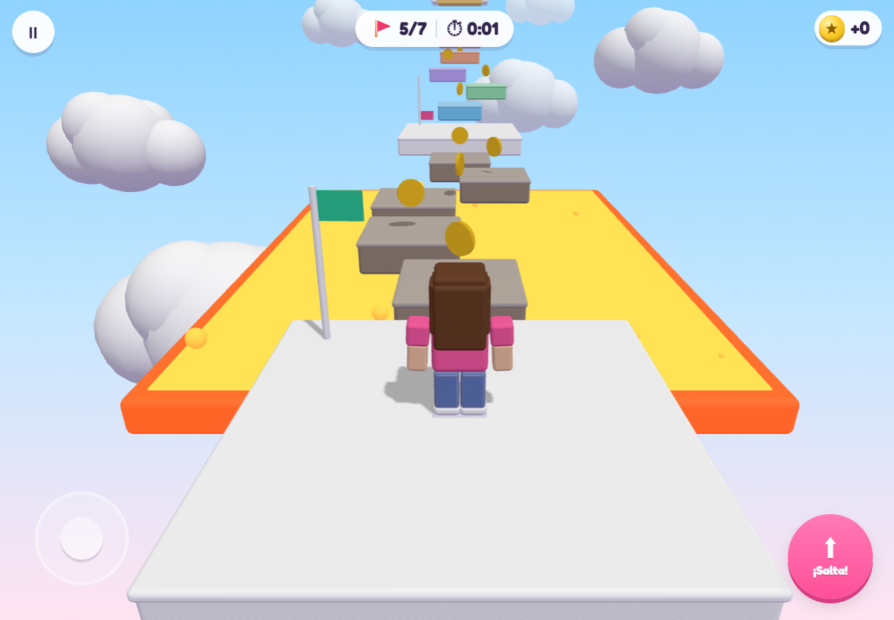
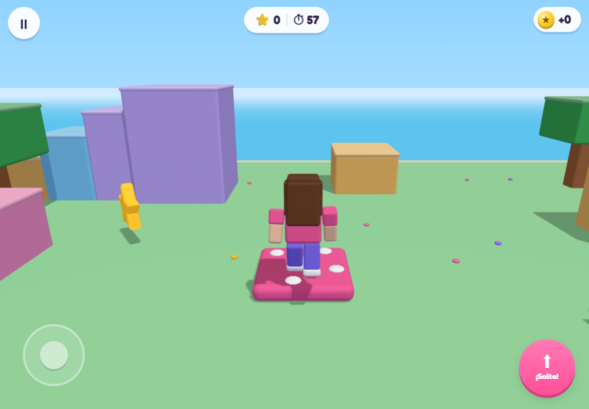
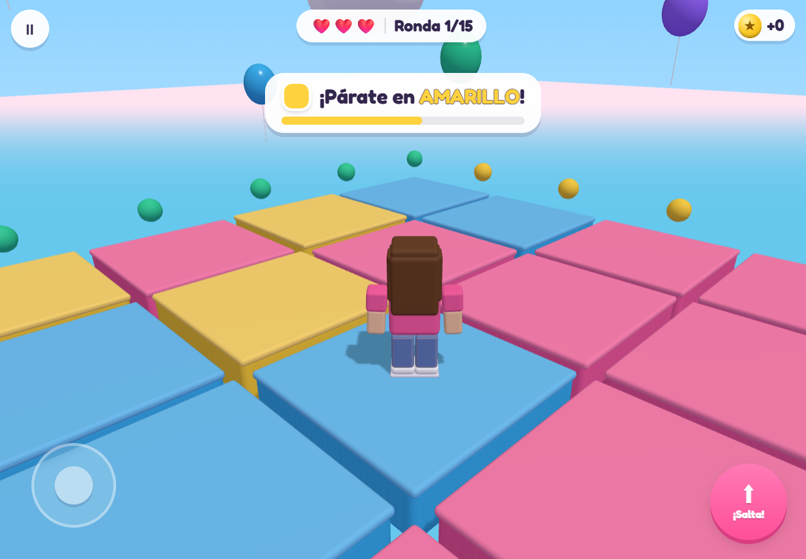
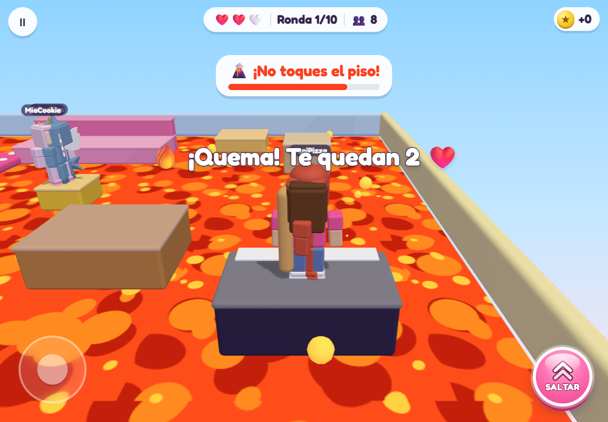
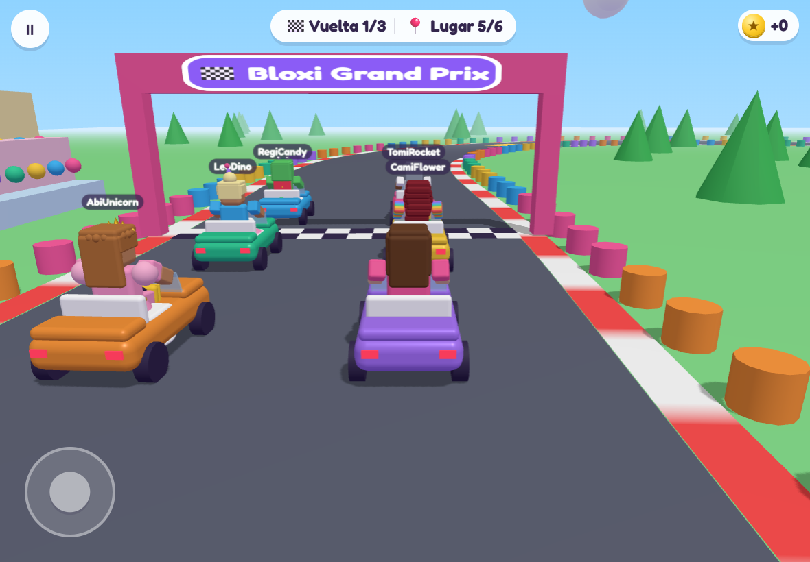
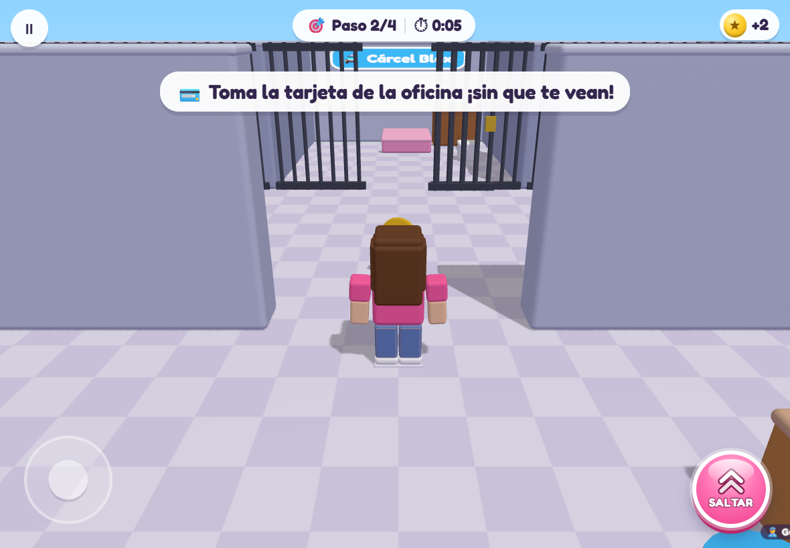
</div>

El catálogo tiene **buscador y categorías**, así que está listo para muchos juegos más.

## 👫 Jugar con amigos (salas privadas)

1. En el Inicio toca **👫 Amigos → Crear sala**. Sale un código como **PANDA-472** (se puede compartir con un toque).
2. Tu amigo toca **👫 Amigos → Unirme** y escribe el código (o abre el link compartido).
3. El anfitrión elige el juego y toca **¡Empezar!**

| Juego en sala | Cómo se juega |
|---|---|
| 🎨 Piso de Colores | Todos en el mismo piso; gana el último en pie. Opción de **rellenar con bots** hasta 8 jugadores |
| ⭐ Atrapa Estrellas | Todos compiten por las mismas estrellas; gana quien junte más. Opción de **rellenar con bots** hasta 5 |
| ☁️ Carrera en el Obby | Se ven todos corriendo; gana quien llegue primero a la meta |

- Hasta 8 jugadores. **Solo entra quien tenga el código**: no hay salas públicas ni chat.
- Los dispositivos se conectan **directo entre ellos** (WebRTC con [PeerJS](https://peerjs.com)). Solo se comparte el nombre y el outfit del Bloxi con quienes están en la sala.
- Los papás pueden apagar las salas en **Ajustes → Para papás**.

## 📲 Instalarlo en el iPad

1. Abre **[edgarleonarchuleta19.github.io/bloxi](https://edgarleonarchuleta19.github.io/bloxi/)** en **Safari**.
2. Toca **Compartir** (el cuadrito con flecha ⬆️).
3. Elige **"Agregar a pantalla de inicio"**.
4. ¡Listo! Se abre como una app y funciona sin internet ✈️

> 💡 **Tip:** activa *Acceso guiado* (Ajustes → Accesibilidad) para que no pueda salirse de la app.

Se juega **acostado (horizontal)** en tablets y celulares. Se navega todo desde el Inicio con botones de regresar (y el botón "atrás" de Android), y los botones del juego se pueden **mover y agrandar** en Ajustes.


## 💾 ¿Dónde se guarda el progreso?

El progreso se guarda **solo en el navegador del dispositivo** y está protegido de varias formas:

- Se guarda en **dos lugares** (localStorage + IndexedDB). Si uno se borra, se recupera del otro automáticamente.
- Le pide al navegador **almacenamiento persistente** para que no lo limpie.
- Al instalarlo en la pantalla de inicio, Safari **no aplica el borrado automático por inactividad** de los sitios web.
- En **Ajustes → Para papás** puedes **descargar una copia** y cargarla en otro iPad.

## 🛠️ Para desarrolladores

Hecho con **React 19 + TypeScript + Vite**, **React Three Fiber** (3D), **Tailwind CSS**, **Motion** (animaciones),
**Zustand** (estado), **vite-plugin-pwa** y **PeerJS** (salas con amigos). Los personajes, la ropa y los mundos se crean con código: no hay modelos ni imágenes
que descargar, y todo pesa ~1.5 MB.

```bash
npm install
npm run dev       # http://localhost:5173
npm test          # un bot recorre las 8 etapas del Obby con la física real para verificar que se puede terminar
npm run build     # genera /dist
npm run thumbs    # con el dev server en :5199, toma capturas del juego para las portadas
```

Cada push a `main` se publica solo en GitHub Pages con [GitHub Actions](.github/workflows/deploy.yml).

<details>
<summary><b>📁 Estructura del proyecto</b></summary>

| Carpeta | Qué hay |
|---|---|
| `src/data/items.ts` | Catálogo de disfraces, ropa, accesorios y precios |
| `src/three/` | El Bloxi en 3D, la ropa, los disfraces y las texturas |
| `src/game/` | Física, controles táctiles, HUD y niveles |
| `src/screens/` | Bienvenida, Inicio, Juegos, Armario y Ajustes |
| `src/lib/backup.ts` | Guardado doble y copias de seguridad |
| `src/net/` | Salas privadas: conexión, sincronización y jugadores remotos |
| `scripts/` | Íconos, portadas de juegos y prueba del Obby |

</details>

<details>
<summary><b>➕ Agregar ropa o juegos</b></summary>

- **Ropa:** en `src/data/items.ts` agrega una línea `top(...)`, `bot(...)` o `shoe(...)` con su forma, color, patrón y estampado.
- **Juego:** agrégalo en `src/screens/games.ts`, crea su nivel en `src/game/levels/`, define su toma en `src/ThumbScene.tsx`
  y corre `npm run thumbs` para generar la portada.

</details>

---

<div align="center">
Hecho con 💖 para mi hermana
</div>
