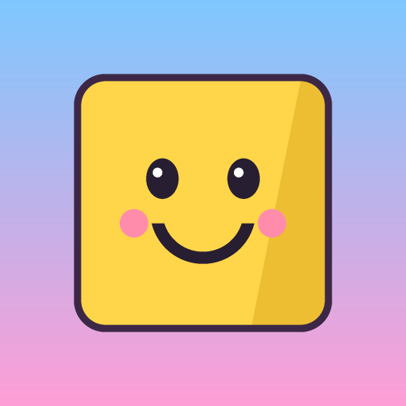
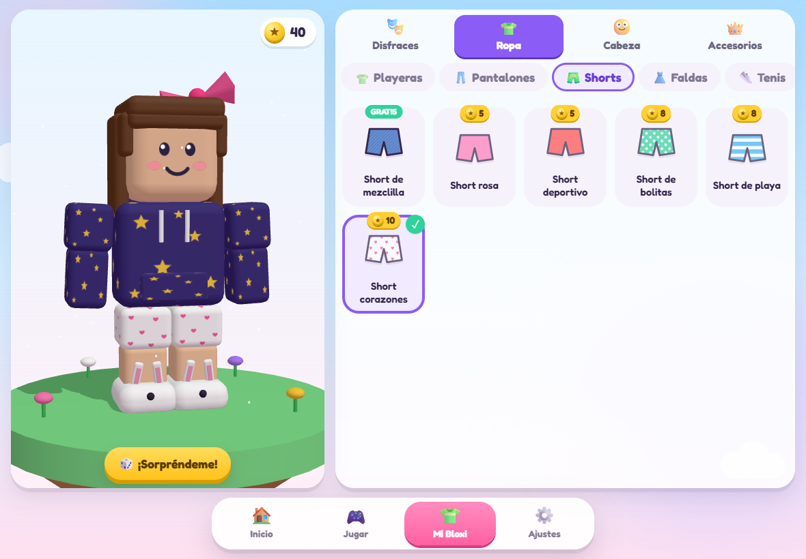
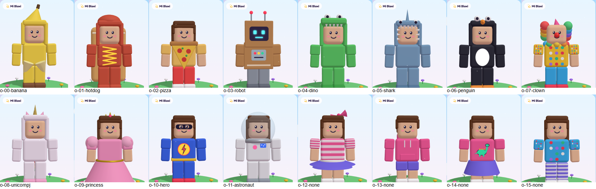
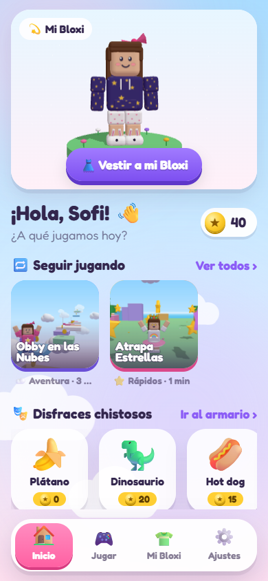

<div align="center">



# Bloxi

**Un mundo 3D de bloques para niños: arma tu monito, vístelo con disfraces chistosos y juega minijuegos.**
Sin cuentas · Sin chat · Sin anuncios · Funciona sin internet

[](https://github.com/EdgarLeonArchuleta19/bloxi/actions/workflows/deploy.yml)

### 👉 [Jugar ahora](https://edgarleonarchuleta19.github.io/bloxi/) 👈


</div>

---

## ✨ ¿Qué es Bloxi?

Bloxi es una app web (PWA) pensada para **tablets como el iPad**. Los niños crean su personaje de bloques, ganan monedas jugando
y las cambian por ropa, disfraces y accesorios. Todo pasa **dentro del dispositivo**: no hay otros jugadores, no se habla con
nadie y no se envía ningún dato a internet.

## 🛡️ Hecho para que sea seguro

| | |
|---|---|
| 🚫 **Sin cuentas** | Solo pide un nombre para saludar, y se queda en el dispositivo |
| 💬 **Sin chat ni multijugador** | Nadie desconocido puede hablarle |
| 💸 **Sin compras reales ni anuncios** | Las monedas solo se ganan jugando |
| 📡 **Sin internet** | Después de abrirlo una vez funciona en modo avión |
| 🔐 **Control para papás** | Borrar el progreso pide resolver una multiplicación |

## 👗 El armario

Casi **90 cosas** para vestir a tu Bloxi. Cada prenda tiene su propio color y diseño, hay **una gratis de cada tipo** y los
precios son bajitos.

<div align="center">

</div>

**🎭 12 disfraces chistosos:** plátano, hot dog, pizza, robot de caja, dinosaurio, tiburón, pingüino, payasito, pijama de unicornio,
princesa, superhéroe y astronauta.



**👕 Ropa:** 17 playeras, 6 pantalones, 6 shorts, 6 faldas y tutús, y 7 tipos de tenis (¡incluye pantuflas de conejo y tenis con luces!).


**👑 Y más:** 9 caras, 7 peinados con 10 colores, 11 gorros, 5 lentes y 7 cosas para la espalda (alas que aletean, capa, jetpack).
También tiene un botón **🎲 ¡Sorpréndeme!** que arma un outfit al azar.

## 🎮 Minijuegos

<div align="center">

</div>

| Juego | De qué se trata |
|---|---|
| ☁️ **Obby en las Nubes** | Parkour en el cielo: plataformas que se mueven, trampolines, 3 checkpoints y un arcoíris en la meta. Si te caes, solo regresas al checkpoint. |
| ⭐ **Atrapa Estrellas** | 60 segundos para juntar estrellas en una isla con árboles, torres y trampolines. ¡Las estrellas arcoíris valen triple! |

<div align="center">


</div>

El catálogo tiene **buscador y categorías**, así que está listo para muchos juegos más.

## 📲 Instalarlo en el iPad

1. Abre **[edgarleonarchuleta19.github.io/bloxi](https://edgarleonarchuleta19.github.io/bloxi/)** en **Safari**.
2. Toca **Compartir** (el cuadrito con flecha ⬆️).
3. Elige **"Agregar a pantalla de inicio"**.
4. ¡Listo! Se abre como una app y funciona sin internet ✈️

> 💡 **Tip:** activa *Acceso guiado* (Ajustes → Accesibilidad) para que no pueda salirse de la app.

Funciona en tablets y celulares, parados y acostados.



## 💾 ¿Dónde se guarda el progreso?

El progreso se guarda **solo en el navegador del dispositivo** y está protegido de varias formas:

- Se guarda en **dos lugares** (localStorage + IndexedDB). Si uno se borra, se recupera del otro automáticamente.
- Le pide al navegador **almacenamiento persistente** para que no lo limpie.
- Al instalarlo en la pantalla de inicio, Safari **no aplica el borrado automático por inactividad** de los sitios web.
- En **Ajustes → Para papás** puedes **descargar una copia** y cargarla en otro iPad.

## 🛠️ Para desarrolladores

Hecho con **React 19 + TypeScript + Vite**, **React Three Fiber** (3D), **Tailwind CSS**, **Motion** (animaciones),
**Zustand** (estado) y **vite-plugin-pwa**. Los personajes, la ropa y los mundos se crean con código: no hay modelos ni imágenes
que descargar, y todo pesa ~1.5 MB.

```bash
npm install
npm run dev       # http://localhost:5173
npm test          # un bot recorre el Obby con la física real para verificar que se puede terminar
npm run build     # genera /dist
npm run thumbs    # con el dev server en :5199, toma capturas del juego para las portadas
```

Cada push a `main` se publica solo en GitHub Pages con [GitHub Actions](.github/workflows/deploy.yml).

<details>
<summary><b>📁 Estructura del proyecto</b></summary>

| Carpeta | Qué hay |
|---|---|
| `src/data/items.ts` | Catálogo de disfraces, ropa, accesorios y precios |
| `src/three/` | El Bloxi en 3D, la ropa, los disfraces y las texturas |
| `src/game/` | Física, controles táctiles, HUD y niveles |
| `src/screens/` | Bienvenida, Inicio, Juegos, Armario y Ajustes |
| `src/lib/backup.ts` | Guardado doble y copias de seguridad |
| `scripts/` | Íconos, portadas de juegos y prueba del Obby |

</details>

<details>
<summary><b>➕ Agregar ropa o juegos</b></summary>

- **Ropa:** en `src/data/items.ts` agrega una línea `top(...)`, `bot(...)` o `shoe(...)` con su forma, color, patrón y estampado.
- **Juego:** agrégalo en `src/screens/games.ts`, crea su nivel en `src/game/levels/`, define su toma en `src/ThumbScene.tsx`
  y corre `npm run thumbs` para generar la portada.

</details>

---

<div align="center">
Hecho con 💖 para mi hermana
</div>
